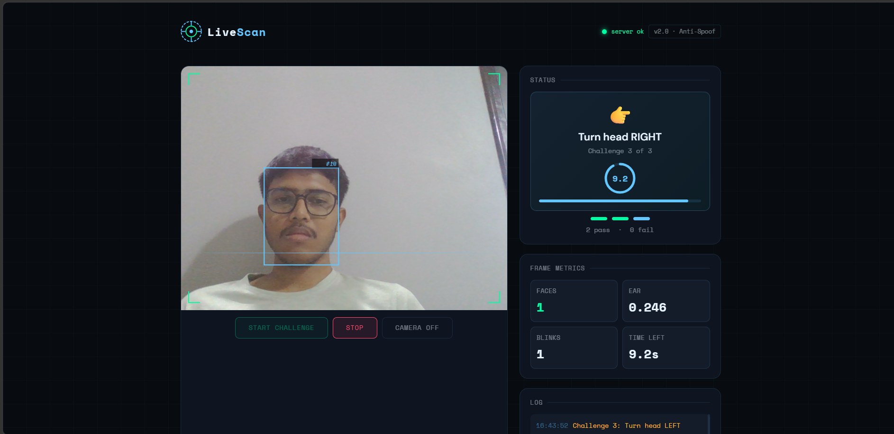

# Face Liveness Detection & Anti-Spoofing

A real-time face liveness detection system that uses camera input, facial landmarks, and interactive challenges to help distinguish a live person from potential spoofing attempts. The project includes a browser-based interface and a FastAPI backend.

## Features

- **Real-time camera input:** Captures frames from the user's webcam.
- **Interactive liveness challenges:** Uses actions such as blinking and head movements to evaluate whether a person is responding to the challenge.
- **Facial landmark analysis:** Uses MediaPipe Face Landmarker to analyze facial features and movements.
- **YOLO-based detection:** Uses trained model weights for the project's detection workflows.
- **Live status and metrics:** Displays challenge progress, face information, blink metrics, and processing status.
- **FastAPI backend:** Provides HTTP endpoints for frame analysis and liveness sessions.
- **Docker support:** Includes a Dockerfile for containerized deployment.

## Tech Stack

- Python
- FastAPI
- OpenCV
- MediaPipe
- Ultralytics YOLO
- NumPy
- SciPy
- HTML, CSS, and JavaScript
- Docker

## Project Structure

```text
antispoof-detection/
├── app.py
├── livelinessui.html
├── requirements.txt
├── Dockerfile
├── .dockerignore
├── best.pt
├── face_weights.pt
├── accessories_weights.pt
└── face_landmarker.task
```

## How It Works

1. The application accesses the user's webcam through the browser.
2. Camera frames are sent to the FastAPI backend for processing.
3. MediaPipe facial landmarks are used to analyze facial geometry and movements.
4. The application presents interactive challenges, including blinking and head movements.
5. The backend evaluates the challenge responses and returns the current liveness status.
6. The interface displays the results and relevant metrics.

The application also contains exam-registration support workflows for photo validation and document processing.

## Getting Started

### Prerequisites

- Python installed on your system
- A working webcam
- Git
- A browser that supports webcam access

### Installation

**1. Clone the repository**

```bash
git clone https://github.com/ramanineel005/antispoof-detection.git
cd antispoof-detection
```

**2. Create a virtual environment**

```bash
python -m venv .venv
```

**3. Activate the virtual environment**

Windows PowerShell:

```powershell
.\.venv\Scripts\Activate.ps1
```

Windows Command Prompt:

```bat
.venv\Scripts\activate.bat
```

Linux or macOS:

```bash
source .venv/bin/activate
```

**4. Install dependencies**

```bash
python -m pip install --upgrade pip
pip install -r requirements.txt
```

### Run the Application

Start the FastAPI server:

```bash
uvicorn app:app --host 127.0.0.1 --port 8000
```

Open the application in your browser:

http://127.0.0.1:8000

The backend API documentation is available at:

http://127.0.0.1:8000/docs

Allow camera access when prompted by the browser.

## API Endpoints

| Method | Endpoint | Purpose |
|---|---|---|
| GET | `/` | Serves the web interface |
| GET | `/health` | Checks backend and model status |
| POST | `/detect` | Analyzes a single uploaded frame |
| POST | `/detect/base64` | Analyzes a frame encoded as Base64 |
| POST | `/session/start` | Starts a liveness session |
| GET | `/session/state` | Retrieves the current session state |
| POST | `/session/update` | Updates a session with a frame |
| POST | `/session/update/base64` | Updates a session with a Base64 frame |

The backend also contains endpoints for exam registration, photo validation, document upload, and verification.

## Docker

Build the Docker image:

```bash
docker build -t antispoof-detection .
```

Run the container:

```bash
docker run --rm -p 8000:8000 antispoof-detection
```

Refer to the Dockerfile and application configuration for any additional environment variables or model-file requirements.

## Limitations

- Liveness decisions depend on the quality of the camera input, lighting, face visibility, and model behavior.
- Interactive challenges provide a basic defense against some spoofing attempts but do not guarantee protection against every attack.
- Performance may vary depending on hardware and installed dependencies.
- This project should not be treated as a production-grade identity verification or security system without further testing and evaluation.

## Future Improvements

- Evaluate performance on diverse lighting conditions and spoofing methods.
- Measure false acceptance and false rejection rates.
- Improve robustness against printed photographs, screen replays, and other presentation attacks.
- Add automated testing and deployment monitoring.
- Improve deployment configuration and documentation.

## Demo Screenshot




## Author

**Neel Ramani**

GitHub: [@ramanineel005](https://github.com/ramanineel005)
